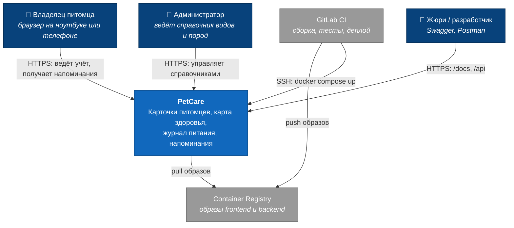
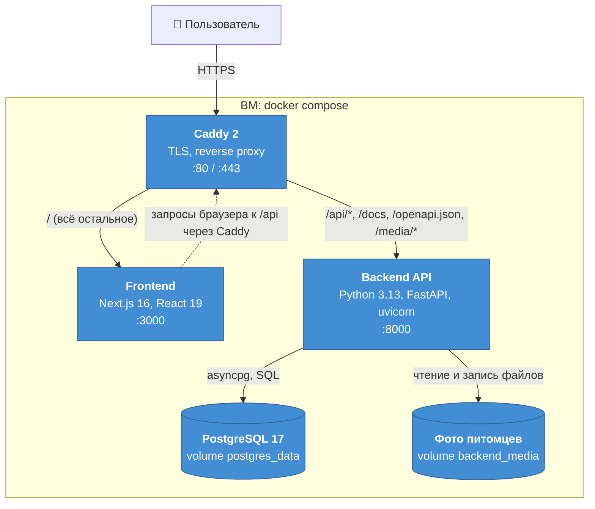
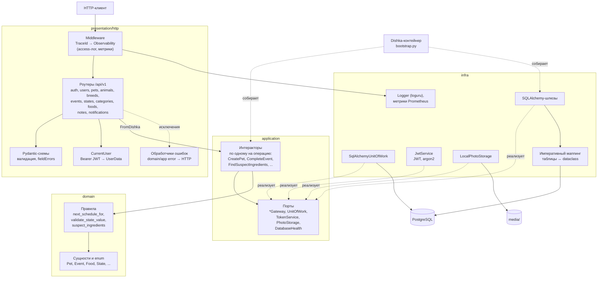
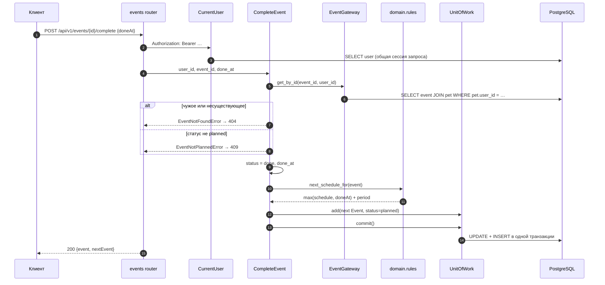
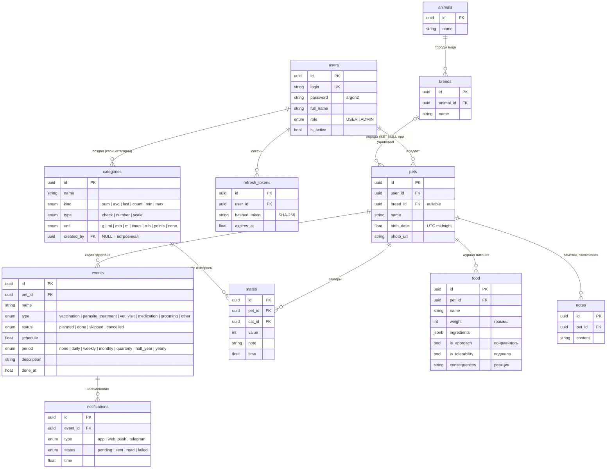
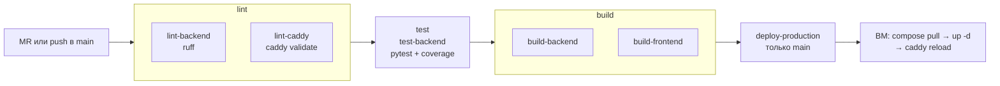

# PetCare — архитектура бэкенда

Документ описывает систему в том виде, в каком она лежит в репозитории и работает на стенде. Всё, что здесь сказано, проверяется кодом, тестами или пайплайном; ссылки ведут на конкретные файлы.

**Содержание**

1. [Требования](#1-требования)
2. [Архитектурные решения](#2-архитектурные-решения)
3. [Диаграммы C4](#3-диаграммы-c4)
4. [Модель данных](#4-модель-данных)
5. [Карта эндпоинтов](#5-карта-эндпоинтов)
6. [Карта репозитория](#6-карта-репозитория)
7. [Запуск](#7-запуск)
8. [Тестирование и покрытие](#8-тестирование-и-покрытие)
9. [CI/CD и эксплуатация](#9-cicd-и-эксплуатация)
10. [Ограничения и развитие](#10-ограничения-и-развитие)

---

## 1. Требования

### 1.1 Пользователь и цель

Основной пользователь — владелец питомца: заводит карточки животных, ведёт историю здоровья и питания и получает напоминания о процедурах. Задача сервиса — собрать разрозненную информацию в одном месте и не дать пропустить прививку, обработку или приём лекарства.

### 1.2 Функциональные требования и их реализация

Нумерация совпадает с разделом 5 «Задания PetCare». Колонка «Тесты» показывает, сколько автотестов проверяют пункт; полный отчёт лежит в [`requirements-coverage.md`](requirements-coverage.md).

| № | Требование | Реализация в API | Статус |
|---|---|---|---|
| 5.1.1 | Создание карточки питомца | `POST /pets`: обязательны только `name` и `breedId` | ✅ |
| 5.1.2 | Имя, вид, порода, дата рождения | Вид следует из породы (`GET /animals` → `GET /breeds?animalId=`), `birthDate` необязательна, в ответе есть `ageMonths` | ✅ |
| 5.1.3 | Фотография | `PUT /pets/{id}/photo` (jpeg, png, webp, до 5 МБ), раздача через `/media/...` | ✅ |
| 5.1.4 | Список питомцев | `GET /pets`: только свои питомцы, новые сверху | ✅ |
| 5.2.1 | История вакцинаций с датами | `events` с `type=vaccination`: `schedule` (план), `doneAt` (факт), `status` | ✅ |
| 5.2.2 | История обработок от паразитов | `events` с `type=parasite_treatment` | ✅ |
| 5.2.3 | Посещения ветеринара | `events` с `type=vet_visit` | ✅ |
| 5.2.4 | Заключения ветеринаров | `description` визита (до 2000 символов) и заметки `notes` в карточке | ✅ |
| 5.2.5 | Вес и другие параметры | Категории (`categories`) и замеры (`states`), агрегат за период: `GET /states/summary` | ✅ |
| 5.3.1 | Записи о кормах | `foods`: название, вес порции, состав | ✅ |
| 5.3.2 | Понравилось / не понравилось | `foods.isApproach` | ✅ |
| 5.3.3 | Подошло / не подошло | `foods.isTolerability` | ✅ |
| 5.3.4 | Нежелательные реакции (ЖКТ, аллергия) | `foods.consequences` и встроенные категории замеров «Проблемы с ЖКТ», «Аллергическая реакция» | ✅ |
| 5.3.5 | Личная база предпочтений | Фильтры `isApproach` / `isTolerability`; `GET /foods/{id}/suspects` находит ингредиенты, которых не было ни в одном подошедшем корме | ✅ |
| 5.4.1 | Расчёт следующей вакцинации | `period` у события; `nextSchedule` в ответе; при выполнении следующее событие создаётся автоматически | ✅ |
| 5.4.2 | Расчёт следующей обработки | То же, что 5.4.1 | ✅ |
| 5.4.3 | Назначения препаратов из заключений | Пока только `events` с `type=medication`; связи с визитом нет | ⚠️ частично |
| 5.4.4 | Длительность и регулярность приёма | Регулярность — через `period`; длительности курса (дата окончания, число приёмов) нет | ⚠️ частично |
| 5.4.5 | Формирование напоминаний | `notifications`, привязанные к событию; `due=true` — наступившие | ✅ |
| 5.4.6 | Список ближайших событий | `GET /events/upcoming?days=`: просроченные помечены `isOverdue` | ✅ |
| 5.4.7 | Push или виджет | Каналы описаны в модели (`app`, `web_push`, `telegram`), отправки пока нет | ❌ в работе |

### 1.3 Нефункциональные требования

| Требование | Как обеспечено |
|---|---|
| Понятные ошибки форм, подсветка поля (п. 7–8 задания) | Единый формат ошибки `{code, message, traceId, timestamp, path, fieldErrors?, details?}`; у `422` есть `fieldErrors[].field` с именем поля из формы (`name`, `password`...) |
| Безопасность | Пароли хешируются argon2. Access JWT (15 мин) передаётся в заголовке, refresh (30 дн.) — в HttpOnly + Secure cookie с ротацией; в БД хранится только SHA-256 refresh-токена. Чужие объекты отвечают `404`, а не `403`, чтобы не раскрывать, что объект существует |
| Целостность данных | Одна транзакция на пользовательскую операцию (Unit of Work); каскадное удаление по внешним ключам |
| Наблюдаемость | `X-Trace-Id` в каждом ответе и строке лога, access-лог, метрики Prometheus на `/metrics`, проверки `/health/liveness` и `/health/readiness` |
| Простота проверки | Swagger на `/docs`, Postman-коллекция, демо-аккаунты `жюри1`…`жюри10`, деплой одной кнопкой из пайплайна |
| Мобильные клиенты | API не зависит от клиента: время передаётся числом Unix seconds, ответы — JSON, пагинация единая |

### 1.4 Вне рамок

Онлайн-консультации, интеграция с госреестрами, маркетплейс, соцсеть и AI-диагностика исключены разделом 8 задания. Поиск подозрительных ингредиентов — детерминированное сравнение множеств, а не модель.

---

## 2. Архитектурные решения

Каждое решение записано в формате «контекст → решение → почему → цена».

### ADR-1. Модульный монолит по Clean Architecture

- **Контекст.** Небольшая команда и сжатый срок; предметная область богаче, чем CRUD: повторяющиеся события, агрегаты замеров, анализ кормов.
- **Решение.** Один сервис с четырьмя слоями: `domain` → `application` → `infra` / `presentation`. Зависимости направлены только внутрь.
- **Почему.** Бизнес-правила (`domain/events/rules.py`, `domain/foods/rules.py`) тестируются без БД и HTTP. Фреймворк и ORM можно заменить, не трогая сценарии. Микросервисы при одном клиенте и одной БД дали бы только накладные расходы.
- **Цена.** Больше файлов на одну сущность (entity, dto, interactor, gateway, schema). Границы слоёв проверяет тест `test_inner_layers_do_not_import_frameworks_or_outer_layers`.

### ADR-2. FastAPI + Pydantic

- **Почему.** Асинхронный ввод-вывод, валидация на входе и автоматическая OpenAPI-схема: Swagger UI работает без ручной документации. Схема сохранена в [`openapi.json`](openapi.json), а тест `test_openapi_matches_the_documented_api_contract` не даёт ей разойтись с кодом.

### ADR-3. PostgreSQL, SQLAlchemy с императивным маппингом, Alembic

- **Решение.** Доменные сущности — обычные `dataclass`; таблицы привязываются к ним в `infra/database/mappings.py`. Миграции применяются при старте контейнера (`alembic upgrade head` в `Dockerfile`).
- **Почему.** Домен не знает об ORM. Postgres даёт `JSONB` для состава корма, внешние ключи с каскадами и транзакции. Автомиграции убирают ручной шаг при деплое.
- **Цена.** Маппинг пишется отдельно от сущности.

### ADR-4. Dishka DI и одна сессия на запрос

- **Решение.** Провайдеры лежат рядом с тем, что предоставляют (`application/<entity>/di.py`). Сессия SQLAlchemy живёт в скоупе запроса и общая для авторизации, шлюзов и Unit of Work.
- **Почему.** Интеракторы получают порты (интерфейсы), а не реализации. Одна сессия гарантирует, что авторизация и запись видят одни и те же данные (тест `test_authentication_gateway_and_uow_share_one_session`).

### ADR-5. Шлюзы для чтения, Unit of Work для записи

- **Решение.** Каждый шлюз реализует явные методы чтения (`get_by_id`, `get_upcoming`, ...). Изменения копятся в UoW и фиксируются одним `commit()` в конце интерактора.
- **Почему.** Составные операции атомарны: регистрация вместе с выдачей токенов, ротация refresh, завершение события вместе с созданием следующего. Откаты проверяет `tests/test_transactions.py`.

### ADR-6. Время — Unix seconds (float, UTC)

- **Почему.** Веб и мобильный клиенты работают в разных часовых поясах. Число без зоны нельзя прочитать неоднозначно, а с дробной частью точность не теряется. Дата рождения нормализуется к полуночи UTC. ISO-строки отклоняются с `422`, чтобы не было двух форматов.
- **Цена.** Клиент форматирует дату сам.

### ADR-7. Повторяющиеся события вместо отдельной сущности «график»

- **Решение.** У события есть `period` (`daily` … `yearly`). При выполнении (через `/complete` или `PATCH status=done`) создаётся следующее событие. Его дата отсчитывается от **более поздней** из двух дат: плановой или фактической.
- **Почему.** Так считают ветеринары: прививку, сделанную на два месяца позже плана, повторяют через год от фактической даты. История остаётся цепочкой реальных событий, а не вычисляемым расписанием. Месячные периоды сдвигаются по календарю, 31-е число ограничивается последним днём месяца (`domain/events/periods.py`).

### ADR-8. Параметры питомца — категории и замеры

- **Решение.** Вес, вода, аппетит, реакции и т. п. — это `categories` с типом значения (`check` 0/1, `scale` 1–5, `number` ≥ 0) и способом агрегации (`sum`, `avg`, `last`, `count`, `min`, `max`). Конкретное значение — запись `states`.
- **Почему.** Пункт 5.2.5 говорит о «других параметрах», и их список заранее неизвестен. Новый параметр добавляется без миграции: встроенными категориями или собственной категорией пользователя.

### ADR-9. Журнал кормов с составом и поиском подозрительных ингредиентов

- **Почему.** Пункт 5.3.5 требует личной базы того, что подходит. Сохраняя состав, сервис отвечает на вопрос владельца «что именно не подошло»: ингредиенты корма, вызвавшего реакцию, минус всё, что встречалось в ранее подошедших кормах. Это простое правило без AI, оно в рамках ограничений задания.

### ADR-10. Фото на томе, раздача через `/media`

- **Почему.** Это самый простой надёжный вариант для одного сервера: Docker volume `backend_media` и статическая раздача. Принимаются только `image/jpeg`, `image/png` и `image/webp` (по `Content-Type`), размер ограничен 5 МБ; файл получает случайное имя. Если запись в БД не удалась, новый файл удаляется, а старый остаётся.
- **Цена.** Горизонтально масштабировать без общего хранилища нельзя. Следующий шаг — S3-совместимое хранилище за портом `PhotoStorage`.

### ADR-11. Деплой: GitLab CI → образы → docker compose на ВМ за Caddy

- **Почему.** Для одного стенда это минимум движущихся частей. Caddy сам получает TLS-сертификат и маршрутизирует `/api`, `/docs`, `/media` на бэкенд, а остальное — на фронтенд. Healthcheck-и и `restart: unless-stopped` поднимают упавшие контейнеры.

### ADR-12. Тесты на SQLite в памяти и контроль Postgres-схемы снимком

- **Почему.** 200+ тестов проходят примерно за 30 секунд без внешних сервисов, поэтому их запускают локально и в CI без Docker. Внешние ключи в SQLite включены, чтобы каскады работали как в Postgres. Расхождения диалектов закрыты отдельными тестами: DDL Postgres сравнивается с сохранённым снимком (`tests/fixtures/schema.json`), SQL миграций проверяется вперёд и назад.

---

## 3. Диаграммы C4

### 3.1 Уровень 1 — контекст системы



### 3.2 Уровень 2 — контейнеры



| Контейнер | Образ | Проверка здоровья | Данные |
|---|---|---|---|
| `caddy` | `caddy:2-alpine` | admin API `:2019/config/` | `caddy_data` (сертификаты) |
| `frontend` | `$FRONTEND_IMAGE` | `GET :3000` | — |
| `backend` | `$BACKEND_IMAGE` | `GET /health/readiness` (проверяет БД) | `backend_media` |
| `postgres` | `postgres:17-alpine` | `pg_isready` | `postgres_data` |

### 3.3 Уровень 3 — компоненты бэкенда



Правило зависимостей: `domain` ничего не импортирует из других слоёв; `application` зависит только от `domain`; `infra` и `presentation` зависят от внутренних слоёв, но не друг от друга (кроме сборки в `main.py` и `bootstrap.py`).

### 3.4 Уровень 4 — код: выполнение повторяющегося события

Сценарий 4 задания: владелец отмечает прививку выполненной, сервис планирует следующую.



---

## 4. Модель данных



Все моменты времени (`created_at`, `updated_at`, `schedule`, `done_at`, `time`, ...) хранятся как `DOUBLE PRECISION` — Unix seconds UTC. При удалении питомца каскадно удаляются его события, замеры, кормления, заметки и уведомления. Миграции лежат в [`alembic/versions`](../alembic/versions):

| Миграция | Что делает |
|---|---|
| `0001_initial_schema` | Пользователи, refresh-токены |
| `0002_breeds_and_pets` | Питомцы, породы |
| `0003_care_tracking` | Категории, замеры, события, уведомления; встроенные категории (вес, корм, вода, «понравился», «подошёл», «проблемы с ЖКТ», «аллергическая реакция»...) |
| `0004_epoch_timestamps` | Перевод всех времён в Unix seconds (обратимо) |
| `0005_user_login` | `email` → `login` |
| `0006_animals_notes_food` | Справочник видов, заметки, журнал питания, общие категории |
| `0007_jury_users` | Демо-аккаунты `жюри1`…`жюри10` (пароль `qwerty12345`) |

---

## 5. Карта эндпоинтов

Базовый путь — `/api/v1`. Интерактивная схема: `https://<домен>/docs`; файл схемы: [`openapi.json`](openapi.json); коллекция Postman: [`petcare.postman_collection.json`](petcare.postman_collection.json).

**Общие правила**

- Авторизация: `Authorization: Bearer <accessToken>` (🔒 в таблицах ниже). Refresh-токен передаётся только в HttpOnly-cookie `refreshToken`.
- Списки принимают `page` (с 0) и `size` (1–100) и отвечают `{items, page, size, total}`.
- Чужой или несуществующий объект в пути — `404`. Ссылка в теле на чужой объект (`petId`, `catId`, `eventId`, `breedId`, `animalId`) — `422` с `code` вида `PET_NOT_FOUND` и `details.field`.
- Ошибка: `{code, message, traceId, timestamp, path, fieldErrors?, details?}`. Коды: `VALIDATION_FAILED`, `UNAUTHORIZED`, `WRONG_LOGIN_OR_PASSWORD`, `USER_INACTIVE`, `FORBIDDEN`, `NOT_FOUND`, `*_NOT_FOUND`, `LOGIN_ALREADY_EXISTS`, `CONFLICT`, `EVENT_NOT_PLANNED`, `CATEGORY_IN_USE`, `SYSTEM_CATEGORY_READ_ONLY`, `INVALID_VALUE`, `FILE_TOO_LARGE`, `UNSUPPORTED_FILE_TYPE`, `INTERNAL_ERROR`.

### Служебные

| Метод | Путь | Назначение |
|---|---|---|
| GET | `/health/liveness` | Процесс жив |
| GET | `/health/readiness` | БД отвечает (`503`, если нет) |
| GET | `/metrics` | Метрики Prometheus |
| GET | `/docs`, `/openapi.json` | Swagger UI и схема |
| GET | `/media/pets/{file}` | Фото питомца |

### Авторизация и профиль

| Метод | Путь | Назначение | Ответы |
|---|---|---|---|
| POST | `/auth/register` | Регистрация `{login, password, fullName}` → `accessToken` + cookie | 201, 409, 422 |
| POST | `/auth/login` | Вход `{login, password}` | 200, 401, 423 |
| POST | `/auth/refresh` | Новый access по cookie, ротация refresh | 200, 401 |
| POST | `/auth/logout` | Отзыв refresh, удаление cookie | 204, 401 |
| GET / PATCH 🔒 | `/users/me` | Профиль, смена `fullName` | 200, 422 |

### Питомцы и справочники (5.1)

| Метод | Путь | Назначение | Требование |
|---|---|---|---|
| GET 🔒 | `/animals?q=` | Виды животных | 5.1.2 |
| POST / PATCH / DELETE 🔒 | `/animals`, `/animals/{id}` | Справочник видов (только `ADMIN`) | — |
| GET 🔒 | `/breeds?animalId=&q=` | Породы вида | 5.1.2 |
| POST / PATCH / DELETE 🔒 | `/breeds`, `/breeds/{id}` | Справочник пород (только `ADMIN`) | — |
| GET 🔒 | `/pets` | Мои питомцы | 5.1.4 |
| POST 🔒 | `/pets` | Создать `{name, breedId, birthDate?}` | 5.1.1, 5.1.2 |
| GET / PATCH / DELETE 🔒 | `/pets/{petId}` | Карточка с `animal`, `breed`, `ageMonths`, `photoUrl` | 5.1 |
| PUT 🔒 | `/pets/{petId}/photo` | Фото (multipart `file`) | 5.1.3 |

### Карта здоровья и напоминания (5.2, 5.4)

| Метод | Путь | Назначение | Требование |
|---|---|---|---|
| GET 🔒 | `/events?petId=&type=&status=&from=&to=` | История и план: прививки, обработки, визиты, лекарства | 5.2.1–5.2.3 |
| POST 🔒 | `/events` | Событие `{petId, name, type, schedule, period, status, description}` | 5.2, 5.4.1 |
| GET 🔒 | `/events/upcoming?days=30&petId=` | Ближайшие, включая просроченные (`isOverdue`) | 5.4.6 |
| GET / PATCH / DELETE 🔒 | `/events/{id}` | Событие; `PATCH status=done` планирует следующее | 5.4.1 |
| POST 🔒 | `/events/{id}/complete` | Выполнено `{doneAt?}` → `{event, nextEvent}` | 5.4.1, 5.4.2 |
| GET 🔒 | `/notifications?eventId=&petId=&status=&due=` | Напоминания; `due=true` — время наступило | 5.4.5 |
| POST / PATCH / DELETE 🔒 | `/notifications`, `/notifications/{id}` | Создать (по умолчанию на время события), отметить `read` | 5.4.5 |
| GET / POST / PATCH / DELETE 🔒 | `/notes?petId=&q=`, `/notes/{id}` | Заметки и заключения | 5.2.4 |

### Параметры и питание (5.2.5, 5.3)

| Метод | Путь | Назначение | Требование |
|---|---|---|---|
| GET / POST 🔒 | `/categories?type=&q=` | Встроенные и пользовательские категории параметров | 5.2.5 |
| GET / PATCH / DELETE 🔒 | `/categories/{id}` | Менять может автор или админ; используемую другими — нельзя (`409`) | 5.2.5 |
| GET / POST 🔒 | `/states?petId=&catId=&from=&to=` | Замеры: вес, аппетит, реакции... | 5.2.5, 5.3.4 |
| GET 🔒 | `/states/summary?petId=&catId=&from=&to=` | Агрегат за период по `kind` категории | 5.2.5 |
| GET / PATCH / DELETE 🔒 | `/states/{id}` | Замер | 5.2.5 |
| GET / POST 🔒 | `/foods?petId=&isApproach=&isTolerability=` | Журнал кормлений и оценки | 5.3.1–5.3.5 |
| GET / PATCH / DELETE 🔒 | `/foods/{id}` | Кормление | 5.3 |
| GET 🔒 | `/foods/{id}/suspects` | Подозрительные ингредиенты | 5.3.5 |

---

## 6. Карта репозитория

```text
petcare/
├── .gitlab-ci.yml               # пайплайн: lint → test → build → deploy
├── docker-compose.yaml          # стенд: caddy + frontend + backend + postgres
├── docker-compose.local.yaml    # локально: backend + postgres
├── .env.example                 # переменные стенда: DOMAIN, образы, секреты
├── deploy/Caddyfile             # TLS и маршрутизация /api, /docs, /media
├── frontend/                    # Next.js 16 (App Router), TanStack Query, Zustand
└── backend/
    ├── Dockerfile               # multi-stage, uv; при старте — alembic upgrade head
    ├── pyproject.toml, uv.lock  # зависимости (зафиксированы)
    ├── ruff.toml, pytest.ini, .coveragerc
    ├── configs/config.yaml      # порт, логирование, JWT, пул БД
    ├── alembic/versions/        # миграции 0001–0007
    ├── scripts/
    │   ├── build_postman_collection.py   # Postman из openapi.json
    │   └── coverage_report.sh            # обновить отчёты покрытия в docs/
    ├── docs/                    # документы сдачи
    │   ├── architecture.md      # этот документ
    │   ├── openapi.json         # контракт API
    │   ├── petcare.postman_collection.json
    │   ├── requirements-coverage.md   # покрытие требований тестами
    │   └── code-coverage.md           # покрытие кода по модулям
    ├── tests/                   # 200+ тестов, см. раздел 8
    └── src/app/
        ├── main.py              # ASGI-приложение: middleware, роутеры, /media
        ├── bootstrap.py         # сборка Dishka-контейнера
        ├── run.py               # локальный запуск uvicorn
        ├── domain/<entity>/     # entity.py, enums.py, rules.py, errors.py, ids.py
        │                        # users, pets, animals, breeds, events, notifications,
        │                        # categories, states, foods, notes, refresh_tokens
        ├── application/
        │   ├── <entity>/        # interactors.py, dto.py, di.py
        │   ├── ports/           # интерфейсы шлюзов, UoW, токенов, фото, health
        │   └── exceptions.py, pagination.py, changes.py
        ├── infra/
        │   ├── database/        # engine, маппинг, UoW, health, DI
        │   ├── gateways/        # SQLAlchemy-реализации портов чтения
        │   ├── security/        # JWT, argon2
        │   ├── photos/          # файловое хранилище фото
        │   └── config.py, logger.py, metrics.py
        └── presentation/http/
            ├── api/endpoints/   # health, metrics
            ├── api/v1/          # роутеры, CurrentUser, обработчики ошибок
            ├── schemas/         # Pydantic-схемы запросов и ответов
            └── middleware/      # trace id, access-лог, метрики
```

Где искать бизнес-правила:

| Правило | Файл |
|---|---|
| Дата следующего события | `src/app/domain/events/rules.py`, `periods.py` |
| Допустимые значения замера | `src/app/domain/states/rules.py` |
| Нормализация состава и подозрительные ингредиенты | `src/app/domain/foods/rules.py` |
| Возраст питомца | `src/app/domain/pets/rules.py` |
| Кто может менять категорию | `src/app/application/categories/interactors.py` |

---

## 7. Запуск

### 7.1 Стенд для проверки

Стенд разворачивается пайплайном из `main` (см. раздел 9). Что доступно:

| Что | Где |
|---|---|
| Приложение | `https://<домен>/` |
| Swagger UI | `https://<домен>/docs` |
| API | `https://<домен>/api/v1/...` |
| Демо-аккаунты | `жюри1` … `жюри10`, пароль `qwerty12345` |

Быстрая проверка в Swagger: `POST /auth/login` → скопировать `accessToken` → **Authorize** → вызывать методы. В Postman: импортировать [`petcare.postman_collection.json`](petcare.postman_collection.json), выставить `baseUrl`, запустить папки по порядку — токен и id созданных объектов сохраняются автоматически.

### 7.2 Локально в Docker (рекомендуется)

Нужен только Docker.

```bash
docker compose -f docker-compose.local.yaml up --build
```

API доступно на `http://localhost:8000`, Swagger — на `http://localhost:8000/docs`. Миграции и демо-аккаунты применяются при старте контейнера.

### 7.3 Локально без Docker

Нужны Python 3.13, [uv](https://docs.astral.sh/uv/) и PostgreSQL с базой `petcare`.

```bash
cd backend
uv sync
cp .env.example .env          # доступ к БД, APP_SECURITY_JWT_SECRET, APP_COOKIE_SECURE=false
uv run alembic upgrade head
uv run python -m app.run      # http://localhost:8080, Swagger — /docs
```

### 7.4 Переменные окружения

| Переменная | Назначение | Пример |
|---|---|---|
| `DB_HOST`, `DB_PORT`, `DB_NAME`, `DB_USER`, `DB_PASSWORD` | Подключение к PostgreSQL | `postgres`, `5432`, `petcare` |
| `APP_SECURITY_JWT_SECRET` | Ключ подписи JWT | 32+ случайных символа |
| `APP_SECURITY_ACCESS_TOKEN_EXPIRATION` | Время жизни access | `15m` |
| `APP_SECURITY_REFRESH_TOKEN_EXPIRATION` | Время жизни refresh | `30d` |
| `APP_COOKIE_SECURE` | Флаг `Secure` у cookie; `false` для локального HTTP | `true` |
| `APP_CORS_ALLOWED_ORIGINS` | Разрешённые origin через запятую | `https://petcare.example` |
| `APP_MEDIA_DIR` | Каталог фото; пусто — `backend/media` | — |

Для стенда (корневой `.env`): `DOMAIN`, `FRONTEND_IMAGE`, `BACKEND_IMAGE`, `DB_PASSWORD`, `APP_SECURITY_JWT_SECRET`.

---

## 8. Тестирование и покрытие

### 8.1 Как запустить

Из каталога `backend/`; БД и `.env` не нужны:

```bash
uv run pytest                               # все тесты + сводка покрытия требований
uv run pytest -m integration                # только сквозные пользовательские сценарии
uv run pytest --cov                         # + покрытие кода в терминале
uv run ruff check .                         # линтер
sh scripts/coverage_report.sh               # обновить docs/requirements-coverage.md и docs/code-coverage.md
```

### 8.2 Уровни тестов

| Уровень | Что проверяет | Файлы |
|---|---|---|
| **Сквозные сценарии** (`-m integration`) | Сценарии 1–4 задания целиком через HTTP: регистрация → питомец с фото → история здоровья → журнал кормов → напоминания и выполнение прививки | `test_user_scenarios.py` |
| **Интеграционные API** | Каждый ресурс через HTTP с настоящей БД (SQLite в памяти): CRUD, фильтры, изоляция пользователей, валидация, каскады | `test_*_endpoints.py`, `test_resilience_and_edge_cases.py` |
| **Транзакции и инфраструктура** | Откат составных операций, общая сессия, UoW, отказ БД → `500`, readiness → `503` | `test_transactions.py`, `test_unit_of_work.py`, `test_resilience_and_edge_cases.py` |
| **Юнит** | Правила домена и сервисы без HTTP: периоды, подозрительные ингредиенты, JWT, cookie, парсинг длительностей, интеракторы авторизации | `test_food_rules.py`, `test_jwt_service.py`, `test_duration.py`, `test_cookies.py`, `test_auth_interactors.py` |
| **Архитектура и контракт** | Границы слоёв, совпадение OpenAPI с `openapi.json`, DDL Postgres со снимком, SQL миграций вперёд и назад | `test_architecture_and_contract.py`, `test_models.py`, `test_timestamps.py` |

### 8.3 Отчёт о покрытии сценариев

Каждый тест помечен пунктами задания, которые он проверяет: `@pytest.mark.req("5.4.1", ...)`. Плагин `tests/req_coverage.py` собирает результаты и в конце прогона печатает таблицу «требование → число тестов → статус». С флагом `--req-report=PATH` он пишет ту же таблицу в Markdown со списком тестов по каждому пункту. Неизвестный id роняет сбор тестов, поэтому каталог требований и тесты не расходятся.

Текущий снимок — [`requirements-coverage.md`](requirements-coverage.md): покрыты 30 из 33 пунктов. Без тестов остаются ровно те пункты, которые ещё не реализованы (5.4.3, 5.4.4, 5.4.7, см. раздел 10).

### 8.4 Покрытие кода

Измеряется `pytest-cov` по строкам и ветвлениям (`.coveragerc`). В конфигурации включён учёт `greenlet` и потоков: без него строки после каждого `await` к БД считаются непокрытыми, и отчёт занижает покрытие примерно на 10 п. п.

| Слой | Покрытие строк |
|---|---|
| `domain` | 99.7 % |
| `application` | 99.2 % |
| `presentation` | 98.6 % |
| `infra` | 91.4 % |
| **Всего (строки + ветвления)** | **96 %** |

По модулям: [`code-coverage.md`](code-coverage.md). Непокрытые строки `infra` — в основном ветки `except SQLAlchemyError` отдельных методов шлюзов; общий путь «ошибка БД → `500 INTERNAL_ERROR`» проверен для каждого шлюза в `test_database_outage_returns_uniform_500`.

### 8.5 Отчёты в CI

Задача `test-backend` публикует:

- процент покрытия в интерфейсе MR и пайплайна (`coverage:`);
- JUnit-отчёт — вкладка **Tests** пайплайна;
- Cobertura — подсветка покрытых строк прямо в diff MR;
- артефакт **backend test reports**: HTML-отчёт покрытия и `requirements-coverage.md`.

---

## 9. CI/CD и эксплуатация



- Бэкенд-задачи запускаются, когда изменены `backend/**` или `.gitlab-ci.yml`, а в `main` — всегда. Образ собирается только после зелёных линта и тестов.
- `deploy-production` копирует на ВМ `docker-compose.yaml`, `Caddyfile` и `.env`, собранный из защищённых переменных GitLab, затем выполняет `docker compose pull && up -d`. `resource_group: production` исключает параллельные деплои.
- Миграции применяются при старте нового контейнера бэкенда, до запуска uvicorn: если миграция упала, API не стартует, а healthcheck это покажет.

**Наблюдаемость**

| Сигнал | Где |
|---|---|
| Логи | stdout контейнера (`docker compose logs backend`) и `logs/petcare.log` с ротацией 10 МБ / 10 дней; в каждой строке `trace_id` |
| Трассировка запроса | `X-Trace-Id` (передан клиентом или сгенерирован) возвращается в заголовке и в теле ошибки |
| Метрики | `/metrics`: `petcare_http_requests_total{method,path,status}`, `petcare_http_request_duration_seconds`, `petcare_http_requests_in_progress`, `petcare_domain_events_total{entity,action}` |
| Здоровье | `/health/liveness`, `/health/readiness` |

Доступ к БД на стенде: `docker compose exec postgres psql -U petcare -d petcare`.

---

## 10. Ограничения и развитие

| Что | Сейчас | План |
|---|---|---|
| Курс препарата (5.4.4) | Только регулярность через `period` | Поля курса: дата окончания или число приёмов, кратность в день; завершение курса прекращает автопланирование |
| Назначения из заключения (5.4.3) | `medication` не связан с визитом | Ссылка `sourceEventId` на `vet_visit`; в ответе визита — список назначений |
| Push-уведомления (5.4.7) | Модель уведомлений есть, отправки нет | Web Push (VAPID): подписки устройства, фоновая отправка наступивших `pending` |
| Автонапоминания | Уведомления создаются клиентом | Генерация при планировании события (за N дней, настраивается пользователем) |
| Периоды по умолчанию | `period` указывает пользователь | Подстановка по типу: прививка — раз в год, обработка — раз в квартал |
| Фото | Локальный том | S3-совместимое хранилище за портом `PhotoStorage` |
