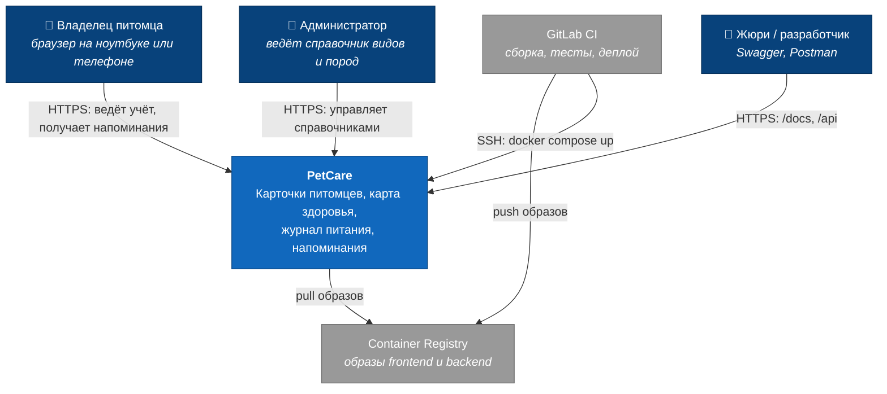
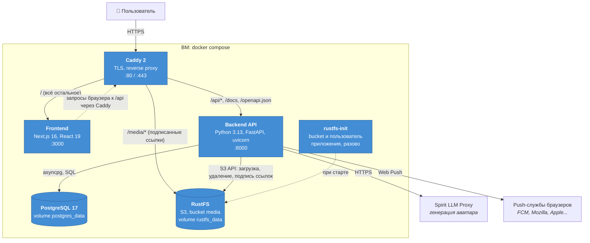
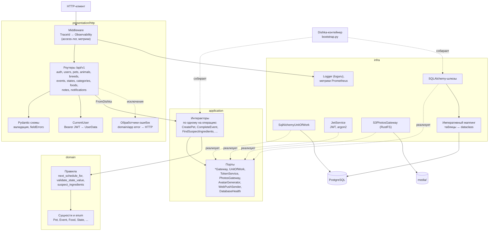
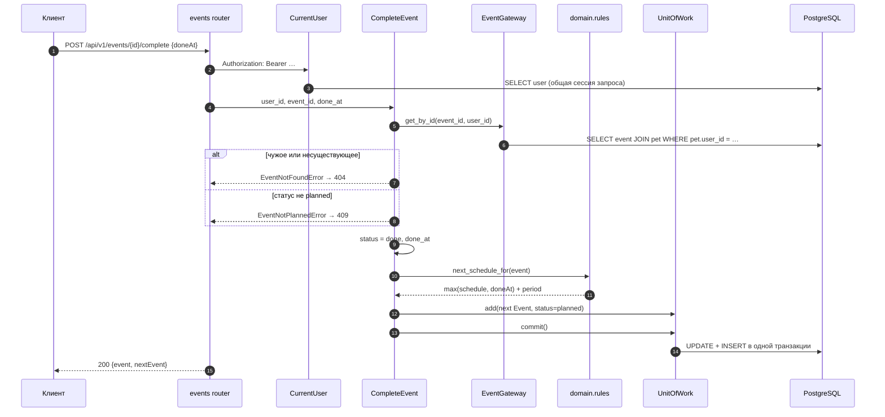
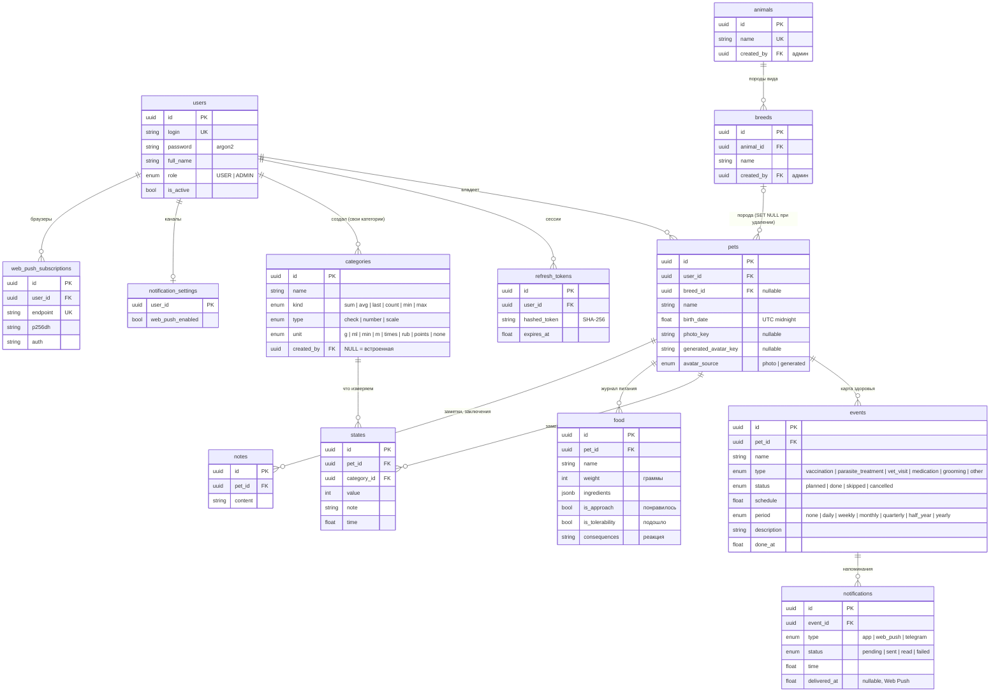
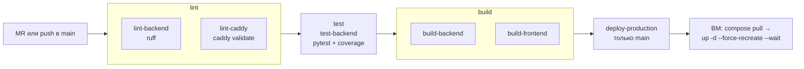

# PetCare — техническая спецификация

Документ описывает систему в том виде, в каком она лежит в репозитории и работает на стенде. Всё, что здесь сказано, проверяется кодом, тестами или пайплайном; ссылки ведут на конкретные файлы.

**Содержание**

1. [Требования](#1-требования)
2. [Архитектурные решения](#2-архитектурные-решения)
3. [Диаграммы C4](#3-диаграммы-c4)
4. [Модель данных](#4-модель-данных)
5. [Карта эндпоинтов](#5-карта-эндпоинтов)
6. [Карта репозитория](#6-карта-репозитория)
7. [Запуск](#7-запуск)
8. [Тестирование и покрытие](#8-тестирование-и-покрытие)
9. [CI/CD и эксплуатация](#9-cicd-и-эксплуатация)
10. [Ограничения и развитие](#10-ограничения-и-развитие)
11. [Подробные контракты подсистем](#11-подробные-контракты-подсистем)

Рядом лежат: [`presentation.pdf`](presentation.pdf) — презентация, [`openapi.json`](openapi.json) — контракт API (Swagger UI на `/docs`), [`db-schema.png`](db-schema.png) — схема БД, [`petcare.postman_collection.json`](petcare.postman_collection.json) — коллекция Postman.

---

## 1. Требования

### 1.1 Пользователь и цель

Основной пользователь — владелец питомца: заводит карточки животных, ведёт историю здоровья и питания и получает напоминания о процедурах. Задача сервиса — собрать разрозненную информацию в одном месте и не дать пропустить прививку, обработку или приём лекарства.

### 1.2 Функциональные требования и их реализация

Нумерация совпадает с разделом 5 «Задания PetCare». Колонка «Тесты» показывает, сколько автотестов проверяют пункт; полный отчёт со списком тестов строит `sh scripts/coverage_report.sh` (раздел 8).

| № | Требование | Реализация в API | Статус |
|---|---|---|---|
| 5.1.1 | Создание карточки питомца | `POST /pets`: обязательны только `name` и `breedId` | ✅ |
| 5.1.2 | Имя, вид, порода, дата рождения | Вид следует из породы (`GET /animals` → `GET /breeds?animalId=`), `birthDate` необязательна, в ответе есть `ageMonths` | ✅ |
| 5.1.3 | Фотография | Прямая загрузка в RustFS по подписанной ссылке или `PUT /pets/{id}/photo` (jpeg, png, webp, до 5 МБ); по фото можно сгенерировать аватар (раздел 11.1) | ✅ |
| 5.1.4 | Список питомцев | `GET /pets`: только свои питомцы, новые сверху | ✅ |
| 5.2.1 | История вакцинаций с датами | `events` с `type=vaccination`: `schedule` (план), `doneAt` (факт), `status` | ✅ |
| 5.2.2 | История обработок от паразитов | `events` с `type=parasite_treatment` | ✅ |
| 5.2.3 | Посещения ветеринара | `events` с `type=vet_visit` | ✅ |
| 5.2.4 | Заключения ветеринаров | `description` визита (до 2000 символов) и заметки `notes` в карточке | ✅ |
| 5.2.5 | Вес и другие параметры | Категории (`categories`) и замеры (`states`), агрегат за период: `GET /states/summary` | ✅ |
| 5.3.1 | Записи о кормах | `foods`: название, вес порции, состав | ✅ |
| 5.3.2 | Понравилось / не понравилось | `foods.isApproach` | ✅ |
| 5.3.3 | Подошло / не подошло | `foods.isTolerability` | ✅ |
| 5.3.4 | Нежелательные реакции (ЖКТ, аллергия) | `foods.consequences` и встроенные категории замеров «Проблемы с ЖКТ», «Аллергическая реакция» | ✅ |
| 5.3.5 | Личная база предпочтений | Фильтры `isApproach` / `isTolerability`; `GET /foods/{id}/suspects` находит ингредиенты, которых не было ни в одном подошедшем корме | ✅ |
| 5.4.1 | Расчёт следующей вакцинации | `period` у события; `nextSchedule` в ответе; при выполнении следующее событие создаётся автоматически | ✅ |
| 5.4.2 | Расчёт следующей обработки | То же, что 5.4.1 | ✅ |
| 5.4.3 | Назначения препаратов из заключений | Пока только `events` с `type=medication`; связи с визитом нет | ⚠️ частично |
| 5.4.4 | Длительность и регулярность приёма | Регулярность — через `period`; длительности курса (дата окончания, число приёмов) нет | ⚠️ частично |
| 5.4.5 | Формирование напоминаний | `notifications`, привязанные к событию; `due=true` — наступившие | ✅ |
| 5.4.6 | Список ближайших событий | `GET /events/upcoming?days=`: просроченные помечены `isOverdue` | ✅ |
| 5.4.7 | Push или виджет | Web Push (VAPID): подписки браузера, фоновая рассылка наступивших напоминаний, проверочное сообщение (раздел 11.3). Экспорт событий в календарь телефона — `GET /events/calendar.ics` (раздел 11.2) | ✅ |
| доп. | Экспорт истории питомца в PDF | `GET /pets/{id}/report`: сводка вместо журнала — ближайшие и просроченные процедуры, история прививок и обработок, график ухода по месяцам, график веса, самочувствие, переносимость кормов с подозрительными ингредиентами, заключения врачей. Удобно отдать ветеринару или новому хозяину | ✅ |

### 1.3 Нефункциональные требования

| Требование | Как обеспечено |
|---|---|
| Понятные ошибки форм, подсветка поля (п. 7–8 задания) | Единый формат ошибки `{code, message, traceId, timestamp, path, fieldErrors?, details?}`; у `422` есть `fieldErrors[].field` с именем поля из формы (`name`, `password`...) |
| Безопасность | Пароли хешируются argon2. Access JWT (15 мин) и refresh (30 дн.) передаются в HttpOnly + Secure cookie с SameSite=Lax; refresh ротируется. Bearer-заголовок access JWT поддерживается и имеет приоритет перед cookie. В БД хранится только SHA-256 refresh-токена. Чужие объекты отвечают `404`, а не `403`, чтобы не раскрывать, что объект существует |
| Целостность данных | Одна транзакция на пользовательскую операцию (Unit of Work); каскадное удаление по внешним ключам |
| Наблюдаемость | `X-Trace-Id` в каждом ответе и строке лога, access-лог, метрики Prometheus на `/metrics`, проверки `/api/v1/health/liveness` и `/api/v1/health/readiness` |
| Простота проверки | Swagger на `/docs`, Postman-коллекция, демо-аккаунты `жюри1`…`жюри10` с готовой историей и админ (`ADMIN_LOGIN`) (у каждого свои питомцы, просроченные и ближайшие процедуры, год замеров и кормлений), деплой одной кнопкой из пайплайна |
| Мобильные клиенты | API не зависит от клиента: время передаётся числом Unix seconds, ответы — JSON, пагинация единая |

### 1.4 Вне рамок

Онлайн-консультации, интеграция с госреестрами, маркетплейс, соцсеть и AI-диагностика исключены разделом 8 задания. Поиск подозрительных ингредиентов — детерминированное сравнение множеств, а не модель.

---

## 2. Архитектурные решения

Каждое решение записано в формате «контекст → решение → почему → цена».

### ADR-1. Модульный монолит по Clean Architecture

- **Контекст.** Небольшая команда и сжатый срок; предметная область богаче, чем CRUD: повторяющиеся события, агрегаты замеров, анализ кормов.
- **Решение.** Один сервис с четырьмя слоями: `domain` → `application` → `infra` / `presentation`. Зависимости направлены только внутрь.
- **Почему.** Бизнес-правила (`domain/events/rules.py`, `domain/foods/rules.py`) тестируются без БД и HTTP. Фреймворк и ORM можно заменить, не трогая сценарии. Микросервисы при одном клиенте и одной БД дали бы только накладные расходы.
- **Цена.** Больше файлов на одну сущность (entity, dto, interactor, gateway, schema). Границы слоёв проверяет тест `test_inner_layers_do_not_import_frameworks_or_outer_layers`.

### ADR-2. FastAPI + Pydantic

- **Почему.** Асинхронный ввод-вывод, валидация на входе и автоматическая OpenAPI-схема: Swagger UI работает без ручной документации. Схема сохранена в [`openapi.json`](openapi.json), а тест `test_openapi_matches_the_documented_api_contract` не даёт ей разойтись с кодом.

### ADR-3. PostgreSQL, SQLAlchemy с императивным маппингом, Alembic

- **Решение.** Доменные сущности — обычные `dataclass`; таблицы привязываются к ним в `infra/database/mappings.py`. Миграции применяются при старте контейнера (`alembic upgrade head` в `Dockerfile`).
- **Почему.** Домен не знает об ORM. Postgres даёт `JSONB` для состава корма, внешние ключи с каскадами и транзакции. Автомиграции убирают ручной шаг при деплое.
- **Цена.** Маппинг пишется отдельно от сущности.

### ADR-4. Dishka DI и одна сессия на запрос

- **Решение.** Провайдеры лежат рядом с тем, что предоставляют (`application/<entity>/di.py`). Сессия SQLAlchemy живёт в скоупе запроса и общая для авторизации, шлюзов и Unit of Work.
- **Почему.** Интеракторы получают порты (интерфейсы), а не реализации. Одна сессия гарантирует, что авторизация и запись видят одни и те же данные (тест `test_authentication_gateway_and_uow_share_one_session`).

### ADR-5. Шлюзы для чтения, Unit of Work для записи

- **Решение.** Каждый шлюз реализует явные методы чтения (`get_by_id`, `get_upcoming`, ...). Изменения копятся в UoW и фиксируются одним `commit()` в конце интерактора.
- **Почему.** Составные операции атомарны: регистрация вместе с выдачей токенов, ротация refresh, завершение события вместе с созданием следующего. Откаты проверяет `tests/infra/test_transactions.py`.

### ADR-6. Время — Unix seconds (float, UTC)

- **Почему.** Веб и мобильный клиенты работают в разных часовых поясах. Число без зоны нельзя прочитать неоднозначно, а с дробной частью точность не теряется. Дата рождения нормализуется к полуночи UTC. ISO-строки отклоняются с `422`, чтобы не было двух форматов.
- **Цена.** Клиент форматирует дату сам.

### ADR-7. Повторяющиеся события вместо отдельной сущности «график»

- **Решение.** У события есть `period` (`daily` … `yearly`). При выполнении (через `/complete` или `PATCH status=done`) создаётся следующее событие. Его дата отсчитывается от **более поздней** из двух дат: плановой или фактической.
- **Почему.** Так считают ветеринары: прививку, сделанную на два месяца позже плана, повторяют через год от фактической даты. История остаётся цепочкой реальных событий, а не вычисляемым расписанием. Месячные периоды сдвигаются по календарю, 31-е число ограничивается последним днём месяца (`domain/events/periods.py`).

### ADR-8. Параметры питомца — категории и замеры

- **Решение.** Вес, вода, аппетит, реакции и т. п. — это `categories` с типом значения (`check` 0/1, `scale` 1–5, `number` ≥ 0) и способом агрегации (`sum`, `avg`, `last`, `count`, `min`, `max`). Конкретное значение — запись `states`.
- **Почему.** Пункт 5.2.5 говорит о «других параметрах», и их список заранее неизвестен. Новый параметр добавляется без миграции: встроенными категориями или собственной категорией пользователя.

### ADR-9. Журнал кормов с составом и поиском подозрительных ингредиентов

- **Почему.** Пункт 5.3.5 требует личной базы того, что подходит. Сохраняя состав, сервис отвечает на вопрос владельца «что именно не подошло»: ингредиенты корма, вызвавшего реакцию, минус всё, что встречалось в ранее подошедших кормах. Это простое правило без AI, оно в рамках ограничений задания.

### ADR-10. Фото в RustFS (S3), раздача по подписанным ссылкам

- **Почему.** Объектное хранилище не привязывает фото к контейнеру бэкенда и позволяет браузеру загружать файл напрямую, минуя API. RustFS — S3-совместимый сервер, который поднимается в том же Compose. Bucket `media` приватный: бэкенд выдаёт подписанные ссылки на чтение (7 дней) и на загрузку (15 минут), а Caddy проксирует `/media/*` на RustFS на том же домене, поэтому CORS не нужен. Бэкенд ходит в хранилище под отдельным пользователем с правами только на `media/pets/*`.
- **Цена.** Один узел RustFS: нужен бэкап тома `rustfs_data`. Неподтверждённые прямые загрузки остаются в bucket, их очистки пока нет.

### ADR-11. Деплой: GitLab CI → образы → docker compose на ВМ за Caddy

- **Почему.** Для одного стенда это минимум движущихся частей. Caddy сам получает TLS-сертификат и маршрутизирует `/api`, `/docs`, `/media` на бэкенд, а остальное — на фронтенд. Healthcheck-и и `restart: unless-stopped` поднимают упавшие контейнеры.

### ADR-12. Тесты на SQLite в памяти и контроль Postgres-схемы снимком

- **Почему.** 340+ тестов проходят примерно за минуту без внешних сервисов, поэтому их запускают локально и в CI без Docker. Внешние ключи в SQLite включены, чтобы каскады работали как в Postgres. Расхождения диалектов закрыты отдельными тестами: DDL Postgres сравнивается с сохранённым снимком (`tests/fixtures/schema.json`), SQL миграций проверяется вперёд и назад.

### ADR-13. Отчёт о питомце: сводка, а не выгрузка журнала

- **Контекст.** За год у питомца набираются сотни записей; владельцу и врачу нужен ответ «что сделано, что пора, как менялся вес, что не подошло», а не лог.
- **Решение.** Интерактор `ExportPetReport` читает историю через шлюзы, чистые функции `application/reports/builder.py` сворачивают её в `PetReport` (процедуры с последней и следующей датой, активность по месяцам, ряды замеров, вердикты по кормам), порт `PetReportRenderer` превращает сводку в PDF. Адаптер `infra/reports/pdf.py` рисует на ReportLab со шрифтом Inter из брендбука PROD и выполняется в пуле потоков, чтобы не блокировать event loop.
- **Почему.** Логика свёртки тестируется без PDF и HTTP; формат можно заменить (HTML, картинка для мессенджера), не трогая сценарий. ReportLab — чистый Python без браузера и системных библиотек, образ остаётся лёгким.
- **Цена.** Графики строятся средствами ReportLab, без интерактивности.

### ADR-14. Демо-данные жюри — миграция, а не скрипт

- **Решение.** Миграция `0009_jury_demo_data` при `alembic upgrade head` (то есть при каждом деплое на чистую базу) создаёт аккаунтам `жюри1`…`жюри10` разных питомцев (кошки, собаки, рыбки — 12 шаблонов) с историей за 1–3 года. Даты считаются от момента применения, поэтому у каждого аккаунта всегда есть просроченная процедура, что-то на этой неделе и год замеров.
- **Почему.** Не нужно ручных шагов при проверке: зашёл — и видно, как продукт выглядит у реального владельца. Генератор `demo_rows` — чистая функция, тесты загружают ту же историю в SQLite и проверяют на ней API и отчёт.
- **Цена.** Откат миграции удаляет питомцев демо-аккаунтов целиком.

---

## 3. Диаграммы C4

### 3.1 Уровень 1 — контекст системы



### 3.2 Уровень 2 — контейнеры



| Контейнер | Образ | Проверка здоровья | Данные |
|---|---|---|---|
| `caddy` | `caddy:2-alpine` | admin API `:2019/config/` | `caddy_data` (сертификаты) |
| `frontend` | `$FRONTEND_IMAGE` | `GET :3000` | — |
| `backend` | `$BACKEND_IMAGE` | `GET /api/v1/health/readiness` (проверяет БД) | — |
| `postgres` | `postgres:17-alpine` | `pg_isready` | `postgres_data` |
| `rustfs` | `rustfs/rustfs:1.0.2` | `GET :9000/health/ready` | `rustfs_data` (фото и аватары) |
| `rustfs-init` | `$BACKEND_IMAGE` | завершается после настройки | — |

### 3.3 Уровень 3 — компоненты бэкенда



Правило зависимостей: `domain` ничего не импортирует из других слоёв; `application` зависит только от `domain`; `infra` и `presentation` зависят от внутренних слоёв, но не друг от друга (кроме сборки в `main.py` и `bootstrap.py`).

### 3.4 Уровень 4 — код: выполнение повторяющегося события

Сценарий 4 задания: владелец отмечает прививку выполненной, сервис планирует следующую.



---

## 4. Модель данных



Все моменты времени (`created_at`, `updated_at`, `schedule`, `done_at`, `time`, ...) хранятся как `DOUBLE PRECISION` — Unix seconds UTC. При удалении питомца каскадно удаляются его события, замеры, кормления, заметки и уведомления. Схема в картинке — [`db-schema.png`](db-schema.png). Миграции лежат в [`alembic/versions`](../alembic/versions):

| Миграция | Что делает |
|---|---|
| `0001_initial_schema` | Пользователи, refresh-токены |
| `0002_breeds_and_pets` | Питомцы, породы |
| `0003_care_tracking` | Категории, замеры, события, уведомления; встроенные категории (вес, корм, вода, «понравился», «подошёл», «проблемы с ЖКТ», «аллергическая реакция»...) |
| `0004_epoch_timestamps` | Перевод всех времён в Unix seconds (обратимо) |
| `0005_user_login` | `email` → `login` |
| `0006_animals_notes_food` | Справочник видов, заметки, журнал питания, общие категории |
| `0007_jury_users` | Демо-аккаунты `жюри1`…`жюри10` (пароль `qwerty12345`) |
| `0008_pet_avatars` | `pets.photo_url` → `photo_key`, сгенерированный аватар и выбор `avatar_source` |
| `0008_states_category_id` | `states.cat_id` → `category_id` вместе с внешним ключом и индексом, данные сохраняются |
| `0009_jury_demo_data` | Демо-история для `жюри1`…`жюри10`: у каждого 2–3 своих питомца с прививками, обработками, визитами, лекарствами, замерами, кормами, заметками и напоминаниями |
| `0010_notification_delivery` | `notifications.delivered_at`, настройки каналов и подписки Web Push |
| `0011_seed_admin` | Админ из `ADMIN_LOGIN` / `ADMIN_PASSWORD`; стартовые виды и породы принадлежат ему |

---

## 5. Карта эндпоинтов

Базовый путь — `/api/v1`. Интерактивная схема: `https://<домен>/docs`; файл схемы: [`openapi.json`](openapi.json); коллекция Postman: [`petcare.postman_collection.json`](petcare.postman_collection.json).

**Общие правила**

- Авторизация (🔒 в таблицах ниже): HttpOnly-cookie `accessToken`, которую ставят вход, регистрация и refresh, или заголовок `Authorization: Bearer <accessToken>` (приоритетнее). Refresh-токен передаётся только в HttpOnly-cookie `refreshToken`.
- Списки принимают `page` (с 0) и `size` (1–100) и отвечают `{items, page, size, total}`.
- Чужой или несуществующий объект в пути — `404`. Ссылка в теле на чужой объект (`petId`, `categoryId`, `eventId`, `breedId`, `animalId`) — `422` с `code` вида `PET_NOT_FOUND` и `details.field`.
- Ошибка: `{code, message, traceId, timestamp, path, fieldErrors?, details?}`. Коды: `VALIDATION_FAILED`, `UNAUTHORIZED`, `WRONG_LOGIN_OR_PASSWORD`, `USER_INACTIVE`, `FORBIDDEN`, `NOT_FOUND`, `*_NOT_FOUND`, `LOGIN_ALREADY_EXISTS`, `CONFLICT`, `EVENT_NOT_PLANNED`, `CATEGORY_IN_USE`, `SYSTEM_CATEGORY_READ_ONLY`, `INVALID_VALUE`, `FILE_TOO_LARGE`, `UNSUPPORTED_FILE_TYPE`, `INTERNAL_ERROR`.

### Служебные

Кроме health, эти пути лежат вне `/api/v1`.

| Метод | Путь | Назначение |
|---|---|---|
| GET | `/api/v1/health/liveness` | Процесс жив |
| GET | `/api/v1/health/readiness` | БД отвечает (`503`, если нет) |
| GET | `/metrics` | Метрики Prometheus |
| GET | `/docs`, `/openapi.json` | Swagger UI и схема |
| GET | `/media/pets/{file}` | Фото питомца |

### Авторизация и профиль

| Метод | Путь | Назначение | Ответы |
|---|---|---|---|
| POST | `/auth/register` | Регистрация `{login, password, fullName}` → `accessToken` + cookie | 201, 409, 422 |
| POST | `/auth/login` | Вход `{login, password}` | 200, 401, 423 |
| POST | `/auth/refresh` | Новый access по cookie, ротация refresh | 200, 401 |
| POST | `/auth/logout` | Отзыв refresh, удаление cookie | 204, 401 |
| GET / PATCH 🔒 | `/users/me` | Профиль, смена `fullName` | 200, 422 |

### Питомцы и справочники (5.1)

| Метод | Путь | Назначение | Требование |
|---|---|---|---|
| GET 🔒 | `/animals?q=` | Виды животных | 5.1.2 |
| POST / PATCH / DELETE 🔒 | `/animals`, `/animals/{id}` | Справочник видов (только `ADMIN`) | — |
| GET 🔒 | `/breeds?animalId=&q=` | Породы вида | 5.1.2 |
| POST / PATCH / DELETE 🔒 | `/breeds`, `/breeds/{id}` | Справочник пород (только `ADMIN`) | — |
| GET 🔒 | `/pets` | Мои питомцы | 5.1.4 |
| POST 🔒 | `/pets` | Создать `{name, breedId, birthDate?}` | 5.1.1, 5.1.2 |
| GET / PATCH / DELETE 🔒 | `/pets/{petId}` | Карточка с `animal`, `breed`, `ageMonths`, `photoUrl` | 5.1 |
| PUT 🔒 | `/pets/{petId}/photo` | Фото (multipart `file`) | 5.1.3 |
| POST 🔒 | `/pets/{petId}/photo/upload-url`, `/pets/{petId}/photo/confirm` | Прямая загрузка фото в хранилище (раздел 11.1) | 5.1.3 |
| POST / PUT / DELETE 🔒 | `/pets/{petId}/avatar/generate`, `/pets/{petId}/avatar`, `/pets/{petId}/avatar/generated` | Сгенерировать аватар по фото (с необязательным пожеланием `prompt`), выбрать, что показывать | доп. |
| GET 🔒 | `/pets/{petId}/report` | PDF-отчёт о здоровье и уходе (`application/pdf`, скачивание) | доп. |

### Карта здоровья и напоминания (5.2, 5.4)

| Метод | Путь | Назначение | Требование |
|---|---|---|---|
| GET 🔒 | `/events?petId=&type=&status=&from=&to=` | История и план: прививки, обработки, визиты, лекарства | 5.2.1–5.2.3 |
| POST 🔒 | `/events` | Событие `{petId, name, type, schedule, period, status, description}` | 5.2, 5.4.1 |
| GET 🔒 | `/events/upcoming?days=30&petId=` | Ближайшие, включая просроченные (`isOverdue`) | 5.4.6 |
| GET 🔒 | `/events/calendar.ics?petId=&alarmMinutes=&until=` | Файл для календаря телефона (раздел 11.2) | 5.4.7 |
| GET / PATCH / DELETE 🔒 | `/events/{id}` | Событие; `PATCH status=done` планирует следующее | 5.4.1 |
| POST 🔒 | `/events/{id}/complete` | Выполнено `{doneAt?}` → `{event, nextEvent}` | 5.4.1, 5.4.2 |
| GET 🔒 | `/notifications?eventId=&petId=&status=&due=` | Напоминания; `due=true` — время наступило | 5.4.5 |
| POST / PATCH / DELETE 🔒 | `/notifications`, `/notifications/{id}` | Создать (по умолчанию на время события), отметить `read` | 5.4.5 |
| GET / PATCH / POST / DELETE 🔒 | `/notifications/settings`, `/notifications/web-push/*`, `/notifications/test` | Канал Web Push: настройки, ключ VAPID, подписки, проверка (раздел 11.3) | 5.4.7 |
| GET / POST / PATCH / DELETE 🔒 | `/notes?petId=&q=`, `/notes/{id}` | Заметки и заключения | 5.2.4 |

### Параметры и питание (5.2.5, 5.3)

| Метод | Путь | Назначение | Требование |
|---|---|---|---|
| GET / POST 🔒 | `/categories?type=&q=` | Встроенные и пользовательские категории параметров | 5.2.5 |
| GET / PATCH / DELETE 🔒 | `/categories/{id}` | Менять может автор или админ; используемую другими — нельзя (`409`) | 5.2.5 |
| GET / POST 🔒 | `/states?petId=&categoryId=&from=&to=` | Замеры: вес, аппетит, реакции... | 5.2.5, 5.3.4 |
| GET 🔒 | `/states/summary?petId=&categoryId=&from=&to=` | Агрегат за период по `kind` категории | 5.2.5 |
| GET / PATCH / DELETE 🔒 | `/states/{id}` | Замер | 5.2.5 |
| GET / POST 🔒 | `/foods?petId=&isApproach=&isTolerability=` | Журнал кормлений и оценки | 5.3.1–5.3.5 |
| GET / PATCH / DELETE 🔒 | `/foods/{id}` | Кормление | 5.3 |
| GET 🔒 | `/foods/{id}/suspects` | Подозрительные ингредиенты | 5.3.5 |

---

## 6. Карта репозитория

```text
petcare/
├── README.md                    # с чего начать
├── .gitlab-ci.yml               # пайплайн: lint → test → build → deploy
├── docker-compose.yaml          # стенд: caddy, frontend, backend, postgres, rustfs
├── compose.local.yaml           # то же локально, сборка из исходников
├── .env.example                 # переменные стенда
├── deploy/                      # Caddyfile и README про деплой
├── frontend/                    # Next.js 16 (App Router), TanStack Query, Zustand
└── backend/
    ├── Dockerfile               # multi-stage, uv; при старте — alembic upgrade head
    ├── pyproject.toml, uv.lock  # зависимости (зафиксированы)
    ├── ruff.toml, pytest.ini, .coveragerc
    ├── alembic/versions/        # миграции 0001–0011
    ├── scripts/                 # Postman из openapi.json, отчёт покрытия, ключи VAPID
    ├── docs/                    # документы сдачи: спецификация, презентация,
    │                            # openapi.json, схема БД, коллекция Postman
    ├── tests/                   # 340+ тестов по папкам уровней, см. раздел 8
    └── src/app/
        ├── main.py              # ASGI-приложение: middleware, роутеры, lifespan
        ├── bootstrap.py         # сборка Dishka-контейнера
        ├── run.py               # локальный запуск uvicorn
        ├── domain/<entity>/     # entity.py, enums.py, rules.py, errors.py, ids.py
        ├── application/
        │   ├── <entity>/        # interactors.py, dto.py, di.py
        │   ├── reports/         # свёртка истории питомца в отчёт, ExportPetReport
        │   ├── notifications/   # рассылка наступивших напоминаний
        │   └── ports/           # интерфейсы шлюзов, UoW, токенов, фото, отчёта, push
        ├── infra/
        │   ├── database/        # engine, маппинг, UoW, health
        │   ├── gateways/        # SQLAlchemy-реализации портов чтения
        │   ├── security/        # JWT, argon2
        │   ├── photos/          # RustFS (S3): загрузка, подписанные ссылки, инициализация
        │   ├── avatars/         # генерация аватара через Spirit LLM Proxy
        │   ├── webpush/         # отправка Web Push (VAPID)
        │   ├── notifications/   # фоновый цикл рассылки
        │   ├── reports/         # PDF на ReportLab, шрифты Inter
        │   └── config.py, logger.py, metrics.py
        └── presentation/http/
            ├── api/endpoints/   # metrics
            ├── api/v1/          # роутеры (включая health), CurrentUser, обработчики ошибок
            ├── schemas/         # Pydantic-схемы запросов и ответов
            └── middleware/      # trace id, access-лог, метрики
```

Где искать бизнес-правила:

| Правило | Файл |
|---|---|
| Дата следующего события | `src/app/domain/events/rules.py`, `periods.py` |
| Допустимые значения замера | `src/app/domain/states/rules.py` |
| Нормализация состава и подозрительные ингредиенты | `src/app/domain/foods/rules.py` |
| Возраст питомца | `src/app/domain/pets/rules.py` |
| Кто может менять категорию | `src/app/application/categories/interactors.py` |

---

## 7. Запуск

### 7.1 Стенд для проверки

Стенд разворачивается пайплайном из `main` (см. раздел 9).

| Что | Где |
|---|---|
| Приложение | `https://<домен>/` |
| Swagger UI | `https://<домен>/docs` |
| API | `https://<домен>/api/v1/...` |
| Демо-аккаунты | `жюри1` … `жюри10`, пароль `qwerty12345`. У каждого свои питомцы с историей: например, `жюри1` — кот Барсик (аллергия на рыбу, просроченная прививка) и овчарка Рекс (курс хондропротектора), `жюри2` — котёнок Мурка, рыбка Голди и корги Тоша |
| Админ | `admin` / `admin12345` (по умолчанию, задаётся `ADMIN_LOGIN` / `ADMIN_PASSWORD`): справочники видов, пород и категорий |
| PDF-отчёт | `GET /api/v1/pets/{id}/report` — в Swagger кнопка **Download file** |

На странице входа есть кнопки быстрого входа за каждого жюри и за админа. Проверка в Swagger: `POST /auth/login` → скопировать `accessToken` → **Authorize** → вызывать методы. В Postman: импортировать [`petcare.postman_collection.json`](petcare.postman_collection.json), выставить `baseUrl`, запустить папки по порядку — токен и id созданных объектов сохраняются автоматически.

### 7.2 Локально

Весь стенд одной командой из корня репозитория (нужен только Docker):

```bash
docker compose -f compose.local.yaml up --build -d --wait   # http://localhost:8080
```

Бэкенд без Docker и все переменные окружения описаны в [`backend/README.md`](../README.md) и [`deploy/README.md`](../../deploy/README.md); справочник переменных — [`backend/.env.example`](../.env.example).

---

## 8. Тестирование и покрытие

### 8.1 Как запустить

Из каталога `backend/`; БД и `.env` не нужны:

```bash
uv run pytest                               # все тесты + сводка покрытия требований
uv run pytest -m integration                # только сквозные пользовательские сценарии
uv run pytest --cov                         # + покрытие кода в терминале
uv run ruff check .                         # линтер
sh scripts/coverage_report.sh               # отчёт покрытия в reports/coverage.md
```

### 8.2 Уровни тестов

Тесты разложены по папкам `backend/tests/` по уровню. Общие фикстуры и HTTP-помощники — в `tests/conftest.py`.

| Папка | Что проверяет |
|---|---|
| `scenarios/` (`-m integration`) | Сценарии 1–4 задания целиком через HTTP: регистрация → питомец с фото → история здоровья → журнал кормов → напоминания и выполнение прививки |
| `api/` | Каждый ресурс через HTTP с настоящей БД (SQLite в памяти): CRUD, фильтры, изоляция пользователей, валидация и границы ввода, каскады, загрузка фото, экспорт календаря, отказ БД → `500`, readiness → `503` |
| `unit/` | Правила домена и сервисы без HTTP: подозрительные ингредиенты, JWT, cookie, парсинг длительностей, интеракторы авторизации, распознавание изображений, формат `.ics` |
| `infra/` | Откат составных операций, общая сессия, UoW, S3-хранилище фото, генерация аватара через LLM, доставка уведомлений (Web Push) |
| `observability/` | Trace id, CORS, метрики, сборка приложения и DI-контейнера |
| `report/` | Демо-история жюри через API, PDF-отчёт (заголовки, страницы, фото), свёртка истории в процедуры; SQL миграции `0009` вперёд и назад |
| `architecture/` | Границы слоёв, совпадение OpenAPI с `openapi.json`, DDL Postgres со снимком, единый формат времени, SQL миграций вперёд и назад |

### 8.3 Отчёт о покрытии сценариев

Каждый тест помечен пунктами задания, которые он проверяет: `@pytest.mark.req("5.4.1", ...)`. Плагин `tests/req_coverage.py` собирает результаты и в конце прогона печатает таблицу «требование → число тестов → статус». С флагом `--req-report=PATH` он пишет ту же таблицу в Markdown со списком тестов по каждому пункту. Неизвестный id роняет сбор тестов, поэтому каталог требований и тесты не расходятся.

Текущий снимок (раздел «Требования» отчёта `scripts/coverage_report.sh`): покрыты 33 из 35 пунктов. Без тестов остаются ровно те пункты, которые ещё не реализованы (5.4.3, 5.4.4, см. раздел 10).

### 8.4 Покрытие кода

Измеряется `pytest-cov` по строкам и ветвлениям (`.coveragerc`). В конфигурации включён учёт `greenlet` и потоков: без него строки после каждого `await` к БД считаются непокрытыми, и отчёт занижает покрытие примерно на 10 п. п.

| Слой | Покрытие строк |
|---|---|
| `domain` | 100 % |
| `application` | 97.9 % |
| `presentation` | 97.5 % |
| `infra` | 85.9 % |
| **Всего (строки + ветвления)** | **94 %** |

По модулям — раздел «Код» того же отчёта; построчный HTML-отчёт — в артефакте CI. Непокрытые строки `infra` — в основном код, который тесты подменяют: создание бакета и пользователя RustFS при старте (`photos/provision.py`), фоновый цикл рассылки уведомлений (`notifications/worker.py`; сама рассылка покрыта через `DispatchDueNotifications`), а также ветки `except SQLAlchemyError` отдельных методов шлюзов; общий путь «ошибка БД → `500 INTERNAL_ERROR`» проверен для каждого шлюза в `test_database_outage_returns_uniform_500`.

### 8.5 Отчёты в CI

Задача `test-backend` публикует:

- процент покрытия в интерфейсе MR и пайплайна (`coverage:`);
- JUnit-отчёт — вкладка **Tests** пайплайна;
- Cobertura — подсветка покрытых строк прямо в diff MR;
- артефакт **backend test reports**: построчный HTML-отчёт покрытия и покрытие требований.

---

## 9. CI/CD и эксплуатация



- Бэкенд-задачи запускаются, когда изменены `backend/**` или `.gitlab-ci.yml`, а в `main` — всегда. Образ собирается только после зелёных линта и тестов.
- `deploy-production` копирует на ВМ `docker-compose.yaml`, `Caddyfile` и `.env`, собранный из защищённых переменных GitLab, затем выполняет `docker compose pull` и `docker compose up -d --force-recreate --wait`. Подробности — в [`deploy/README.md`](../../deploy/README.md). `resource_group: production` исключает параллельные деплои.
- Миграции применяются при старте нового контейнера бэкенда, до запуска uvicorn: если миграция упала, API не стартует, а healthcheck это покажет.

**Наблюдаемость**

| Сигнал | Где |
|---|---|
| Логи | stdout контейнера (`docker compose logs backend`); в каждой строке `trace_id` |
| Трассировка запроса | `X-Trace-Id` (передан клиентом или сгенерирован) возвращается в заголовке и в теле ошибки |
| Метрики | `/metrics`: `petcare_http_requests_total{method,path,status}`, `petcare_http_request_duration_seconds`, `petcare_http_requests_in_progress`, `petcare_domain_events_total{entity,action}` |
| Здоровье | `/api/v1/health/liveness`, `/api/v1/health/readiness` |

Доступ к БД на стенде: `docker compose exec postgres psql -U petcare -d petcare`.

---

## 10. Ограничения и развитие

| Что | Сейчас | План |
|---|---|---|
| Курс препарата (5.4.4) | Только регулярность через `period` | Поля курса: дата окончания или число приёмов, кратность в день; завершение курса прекращает автопланирование |
| Назначения из заключения (5.4.3) | `medication` не связан с визитом | Ссылка `sourceEventId` на `vet_visit`; в ответе визита — список назначений |
| Каналы уведомлений | Только Web Push | Telegram; виджет на рабочем столе |
| Автонапоминания | Уведомления создаются клиентом | Генерация при планировании события (за N дней, настраивается пользователем) |
| Периоды по умолчанию | `period` указывает пользователь | Подстановка по типу: прививка — раз в год, обработка — раз в квартал |
| Хранилище фото | Один узел RustFS, неподтверждённые загрузки не чистятся | Периодическая очистка сирот, реплицируемое хранилище |

---

## 11. Подробные контракты подсистем

Разделы для фронтенда и интеграций: как устроены фото и аватар, экспорт в календарь телефона и Web Push. Полные схемы запросов и ответов — в [`openapi.json`](openapi.json).

### 11.1 Фото и аватар питомца

Бэкенд принимает фото, генерирует по нему аватар и отдаёт выбранную картинку. Обе картинки хранятся в приватном RustFS через aioboto3 и `PhotosGateway`; конфигурации и сервисы предоставляет Dishka.

#### Что делает пользователь

1. Загружает фото питомца.
2. Может попросить стилизованный аватар. Его рисуют по этому фото, не из текста.
3. Выбирает, что показывать: загруженное фото или аватар.

Пока выбор не сделан, показывается фото. Новая загрузка фото удаляет старый аватар и снова ставит показ на фото.

#### API

Все методы требуют авторизацию. Чужой питомец — `404`.

`PUT /api/v1/pets/{petId}/photo`
`multipart/form-data`, поле `file`. jpeg, png или webp, до 5 МБ.

`POST /api/v1/pets/{petId}/avatar/generate`
Тело необязательно. Без него аватар строится по зашитому стилю. С пожеланием:

```json
{ "prompt": "в красном шарфе" }
```

`prompt` — до 120 символов, только внешний вид: цвет, аксессуар, фон, настроение. Буквы, цифры и знаки `. , ! ? ' - « »`. Просьбы сделать что-то другое (поиск, код, «игнорируй инструкции») не доходят до модели: `422 AVATAR_PROMPT_REJECTED`, поле `prompt`. Пустая строка значит то же, что тела нет.

Ответ может идти до трёх минут: на фронте нужен долгий таймаут и состояние загрузки. `avatarSource` этот метод не меняет.

`PUT /api/v1/pets/{petId}/avatar`

```json
{ "source": "photo" }
```

или `"generated"`.

В карточке питомца (`GET /api/v1/pets` и `GET /api/v1/pets/{petId}`):

| Поле | Смысл |
|---|---|
| `photoUrl` | оригинал или `null` |
| `generatedAvatarUrl` | аватар или `null` |
| `avatarSource` | `photo` или `generated` |
| `avatarUrl` | что показывать в интерфейсе |

Ошибки:

| Код | Когда |
|---|---|
| `422 PET_PHOTO_REQUIRED` | генерация или выбор фото, а фото нет |
| `422 GENERATED_AVATAR_MISSING` | выбрали аватар, а его ещё не генерировали |
| `422 AVATAR_PROMPT_REJECTED` | `prompt` длиннее 120 символов, с посторонними символами или не про внешний вид |
| `413` | файл больше 5 МБ |
| `415` | не jpeg/png/webp |
| `422 PHOTO_UPLOAD_NOT_FOUND` | confirm с чужим, несуществующим или не тем ключом |
| `502 AVATAR_GENERATION_FAILED` | Spirit не вернул картинку |
| `503 AVATAR_GENERATION_UNAVAILABLE` | не задан `LLM_PROXY_API_KEY` |

Ссылки подписанные и живут `S3_PRESIGNED_TTL` секунд (по умолчанию 604800 — 7 дней). Если картинка перестала открываться, карточку питомца нужно запросить заново.

#### Прямая загрузка

Браузер кладёт файл сразу в хранилище по подписанной ссылке. Байты через backend не проходят. Пока нет confirm, карточка питомца не меняется.

1. `POST /api/v1/pets/{petId}/photo/upload-url`

```json
{ "contentType": "image/jpeg", "size": 12345 }
```

`contentType` — `image/jpeg`, `image/png` или `image/webp`. `size` — байты, от 1 до 5 МБ. В ответе `key`, `uploadUrl`, `method` (`PUT`), `headers`, `expiresAt` и `maxBytes`.

2. Браузер отправляет файл на `uploadUrl`. `Content-Type` должен совпасть с `headers`: этот заголовок входит в подпись.

```js
await fetch(uploadUrl, { method: "PUT", headers, body: file })
```

Ссылка живёт 15 минут (`S3_UPLOAD_TTL`, по умолчанию 900).

3. `POST /api/v1/pets/{petId}/photo/confirm` с телом `{"key": "<key из шага 1>"}`. В ответе питомец: новое фото, `avatarSource` снова `photo`, старый сгенерированный аватар сброшен.

4. Дальше, как раньше: `POST .../avatar/generate`, затем `PUT .../avatar`.

Пропустить фото или аватар — просто не вызывать эти методы.

`DELETE /api/v1/pets/{petId}/photo` удаляет фото и аватар, собранный из него. `DELETE /api/v1/pets/{petId}/avatar/generated` удаляет только аватар и, если он был выбран, возвращает показ на фото. Повторный вызов ничего не удаляет.

`PUT /api/v1/pets/{petId}/photo` остаётся запасным путём: файл идёт через backend.

В production загрузка идёт на тот же домен (`https://<DOMAIN>/media/...`), отдельный CORS не нужен. Локально RustFS часто на другом порту: тогда браузеру нужен CORS на хранилище, либо используйте multipart `PUT /photo`.

Неподтверждённые загрузки остаются в bucket как сироты. Очистки пока нет.

#### Фронт

1. Форма загрузки берёт ссылку из раздела «Прямая загрузка». `PUT .../photo` — запасной путь, не base64.
2. После ответа показывает `photoUrl` и, если есть, `generatedAvatarUrl`.
3. Кнопка «Сделать аватар» вызывает `POST .../avatar/generate` и ждёт ответ.
4. Две кнопки выбора вызывают `PUT .../avatar`.
5. В списках и виджете картинка берётся из `avatarUrl`.

### 11.2 Календарь телефона (`.ics`)

`GET /api/v1/events/calendar.ics` отдаёт один файл iCalendar. Пользователь сохраняет его и импортирует в календарь телефона: Google, Apple или любой другой, который открывает `.ics`.

Ответ — текст, не JSON. Схема в [`openapi.json`](openapi.json) описывает только заголовки и код ответа.

#### Запрос

```
GET /api/v1/events/calendar.ics?petId=&alarmMinutes=1440&until=
Cookie: accessToken=<access JWT>      # или Authorization: Bearer <accessToken>
```

| Параметр | Смысл |
|---|---|
| `petId` | необязательный UUID. Оставляет события одного питомца. Без него — все питомцы пользователя |
| `alarmMinutes` | за сколько минут до события поставить напоминание. По умолчанию `1440` (сутки). От `0` до `10080` (неделя). `0` — без напоминания |
| `until` | конец ряда повторов и верхняя граница `schedule`. Unix seconds в UTC; дробные секунды допустимы. Если не передан — момент запроса плюс 365 дней. Должен быть больше текущего времени и не дальше чем на 1826 дней (5 лет). Иначе `422` и `fieldErrors` по полю `until` |

В файл попадают только события со статусом `planned`, включая просроченные, у которых `schedule` не позже `until`. Событие с `schedule` позже `until` не попадает — ни разовое, ни повторяющееся. Выполненные, пропущенные и отменённые не попадают. Чужие события не попадают. Сортировка по `schedule` по возрастанию, не больше 1000 записей уже после этого отбора: если их больше, в файл идут самые поздние.

Пустой список всё равно отвечает `200` и валидным календарём без событий.

#### Ответ

`200`

| Заголовок | Значение |
|---|---|
| `Content-Type` | `text/calendar; charset=utf-8` |
| `Content-Disposition` | `attachment; filename="petcare.ics"`. С `petId`: `filename="petcare-<petId>.ics"` |

Каждое событие в файле:

| Поле | Откуда |
|---|---|
| `SUMMARY` | `{имя питомца}: {название события}` |
| `DESCRIPTION` | тип по-русски. Если у события есть описание — пустая строка и оно |
| `CATEGORIES` | тот же русский тип |
| `DTSTART` | `schedule` в UTC, доли секунды отбрасываются |
| `DTEND` | час после начала |
| `UID` | `{id события}@petcare` |
| `RRULE` | правило повтора с концом `UNTIL`, см. таблицу. У `period=none` правила нет |
| `VALARM` | `TRIGGER:-PT{alarmMinutes}M`. Нет, если `alarmMinutes=0` |

Тип в файле:

| `type` | Подпись |
|---|---|
| `vaccination` | Прививка |
| `parasite_treatment` | Обработка от паразитов |
| `vet_visit` | Визит к ветеринару |
| `medication` | Лекарство |
| `grooming` | Груминг |
| `other` | Другое |

Повтор:

| `period` | `RRULE` |
|---|---|
| `daily` | `FREQ=DAILY;UNTIL=YYYYMMDDTHHMMSSZ` |
| `weekly` | `FREQ=WEEKLY;UNTIL=YYYYMMDDTHHMMSSZ` |
| `monthly` | `FREQ=MONTHLY;UNTIL=YYYYMMDDTHHMMSSZ` |
| `quarterly` | `FREQ=MONTHLY;INTERVAL=3;UNTIL=YYYYMMDDTHHMMSSZ` |
| `half_year` | `FREQ=MONTHLY;INTERVAL=6;UNTIL=YYYYMMDDTHHMMSSZ` |
| `yearly` | `FREQ=YEARLY;UNTIL=YYYYMMDDTHHMMSSZ` |
| `none` | строки нет |

`UNTIL` — это `until` запроса в UTC, доли секунды отбрасываются. `DTSTART` тоже в UTC, поэтому `UNTIL` пишется с `Z`. Ряд обрывается на этой дате: телефон не растягивает его дальше.

Пример одного события (строки в файле заканчиваются `\r\n`):

```text
BEGIN:VEVENT
UID:11111111-1111-4111-8111-111111111111@petcare
DTSTAMP:20261101T100000Z
DTSTART:20261101T100000Z
DTEND:20261101T110000Z
SUMMARY:Барсик: Прививка от бешенства
DESCRIPTION:Прививка\n\nНобивак
CATEGORIES:Прививка
RRULE:FREQ=YEARLY;UNTIL=20271101T100000Z
BEGIN:VALARM
ACTION:DISPLAY
DESCRIPTION:Барсик: Прививка от бешенства
TRIGGER:-PT1440M
END:VALARM
END:VEVENT
```

#### Ошибки

Формат как у остальных методов: `{code, message, traceId, timestamp, path, details?}`.

| Статус | Когда |
|---|---|
| `401 UNAUTHORIZED` | нет или плохой токен |
| `404 NOT_FOUND` | `petId` не существует или принадлежит другому пользователю. Сообщение «Pet not found», как у карточки питомца. Это не `422 PET_NOT_FOUND`: тот код бывает у `petId` в теле запроса |
| `422` | `alarmMinutes` вне `0…10080`, `until` не число, не больше текущего времени или дальше 1826 дней, или `petId` не UUID. В теле `fieldErrors` |

#### Фронт

Файл нельзя разобрать как JSON. Запрос с cookie авторизации, тело сохранить как blob.

Передайте `until` — конец периода, который выбрал пользователь, — как Unix seconds. Например, конец месяца или года на экране календаря. Без параметра повторы оборвутся через 365 дней от запроса.

```ts
const until = Math.floor(Date.now() / 1000) + 365 * 24 * 60 * 60;
const response = await fetch(`/api/v1/events/calendar.ics?until=${until}`, {
  credentials: "include",
});
const blob = await response.blob();
const url = URL.createObjectURL(blob);
const link = document.createElement("a");
link.href = url;
link.download = "petcare.ics";
link.click();
URL.revokeObjectURL(url);
```

Имя файла можно взять из `Content-Disposition`, если передан `petId`.

Повторный импорт после новых событий может задвоить повторы. Когда событие отмечают выполненным, сервер создаёт следующее отдельной записью, а старый файл уже содержит `RRULE` до своего `UNTIL` на ту же серию. Перед повторным скачиванием лучше сказать пользователю удалить прежний импорт PetCare.

### 11.3 Внешние напоминания (Web Push)

Бэкенд по-прежнему хранит уведомления и отдаёт `GET /api/v1/notifications?due=true` для тостов в приложении. Поле `status` значит то же, что раньше: фронт сам переводит его в `read`. Отдельное поле `deliveredAt` значит, что хотя бы одно устройство приняло пуш, либо все оставшиеся подписки отозваны. Пока оно пустое и время наступило, фоновый цикл пытается отправить напоминание.

Пока пользователь не включил Web Push, снаружи ничего не уходит, а список `due=true` работает как раньше.

#### Что делает пользователь

1. Открывает настройки уведомлений.
2. Включает Web Push. Сайт запрашивает разрешение и отправляет подписку браузера.
3. Кнопка «Проверить» вызывает `POST /notifications/test` и показывает, ответил ли канал.

#### API

Все методы ниже требуют авторизацию. Их пути объявлены раньше `/{notificationId}`, чтобы слово `settings` не считалось идентификатором.

`GET /api/v1/notifications/settings`

```json
{
  "webPushEnabled": false,
  "webPushAvailable": true
}
```

`webPushAvailable` — заданы ли ключи VAPID.

`PATCH /api/v1/notifications/settings` принимает `webPushEnabled`.

| Код | Когда |
|---|---|
| `503 WEB_PUSH_NOT_CONFIGURED` | включают Web Push или просят публичный ключ, а VAPID не задан |

`GET /api/v1/notifications/web-push/public-key` → `{ "publicKey": "<base64url>" }`.

`POST /api/v1/notifications/web-push/subscriptions` — объект `PushSubscription` из браузера:

```json
{
  "endpoint": "https://push.example.com/...",
  "expirationTime": null,
  "keys": { "p256dh": "...", "auth": "..." }
}
```

Повтор с тем же `endpoint` обновляет ключи и владельца. `expirationTime` принимается и не хранится. `endpoint` — только `https`, не длиннее 2048 символов; хост должен совпадать с суффиксом из `WEB_PUSH_ALLOWED_HOSTS` или быть его поддоменом, иначе `422`. `p256dh` и `auth` не длиннее 255 символов.

`DELETE /api/v1/notifications/web-push/subscriptions` — `endpoint` в query или в JSON. Чужая и отсутствующая подписка не удаляются, ответ всё равно `204`.

`POST /api/v1/notifications/test` сразу шлёт проверку, если Web Push включён:

```json
{
  "channels": [
    { "channel": "web_push", "ok": false, "error": "no_subscriptions" }
  ]
}
```

Пустой `channels` — канал выключен. `no_subscriptions` — Web Push включён, а подписок нет. `not_configured` — ключи VAPID не заданы. `delivery_failed` — ни одно устройство не приняло пуш. `partial_failure` — хотя бы одно устройство приняло пуш, другое нет; `ok` при этом `true`. `subscription_gone` — служба пуша ответила 404 или 410, подписка удалена.

В карточке уведомления добавилось необязательное `deliveredAt`: хотя бы одно устройство приняло пуш, либо все оставшиеся подписки отозваны. `status` этот цикл не меняет.

#### Фронт

Тосты не трогать: опрос `due=true` и `PATCH` статуса остаются.

Настройки:

1. `GET /notifications/settings`.
2. Если `webPushAvailable` ложь, кнопку Web Push не показывать.
3. Тумблер вызывает `PATCH /notifications/settings` с `webPushEnabled`.

Web Push, в уже зарегистрированном service worker:

1. `GET /notifications/web-push/public-key`.
2. `pushManager.subscribe({ userVisibleOnly: true, applicationServerKey })`. Ключ из ответа — base64url; его нужно перевести в `Uint8Array` перед subscribe.
3. `POST /notifications/web-push/subscriptions` с `subscription.toJSON()`.
4. При выходе или отказе — `DELETE` с тем же `endpoint`.

Service worker на событии `push` читает JSON `{ title, body, notificationId, eventId, petId, url }`. `url` сейчас всегда `"/"`. У проверочного сообщения идентификаторы равны `null`. Показ через `registration.showNotification(title, { body, data })`. По клику открывать `data.url`.

Ответ пуша 404 или 410 значит, что браузер отозвал подписку. Бэкенд удаляет её сам. Имеет смысл подписаться заново при следующем заходе.

#### Что происходит на сервере

Раз в `NOTIFICATIONS_DISPATCH_INTERVAL` секунд (по умолчанию 15) выбираются записи со `status=pending`, временем не позже текущего и не старше `NOTIFICATIONS_MAX_LATENESS` секунд (по умолчанию сутки), у которых пустой `deliveredAt`, владелец питомца включил Web Push и есть хотя бы одна подписка. Если ключи VAPID не заданы, запись не захватывается. Иначе она атомарно помечается `deliveredAt=now` условием `delivered_at IS NULL`. Второй процесс видит, что строка уже занята, и не шлёт её снова. Если ни одно устройство не приняло пуш и хотя бы одно ответило ошибкой, кроме 404 и 410, метка снимается: следующий проход повторяет отправку, пока напоминание не старше `NOTIFICATIONS_MAX_LATENESS`. Если приняло хотя бы одно устройство или все оставшиеся подписки отозваны, метка остаётся. Ошибка одной подписки или одной записи пишется в лог и не останавливает цикл. Рассылка может работать на каждом процессе: захват строки не даёт послать дважды. Поле `type` диспетчер не использует: внешняя доставка определяется настройками пользователя.

Web Push получает `title` «Напоминание: <событие>», `body` с именем питомца и временем в UTC, плюс идентификаторы и `url`.

Ключи VAPID:

```bash
uv run python scripts/generate_vapid_keys.py
```

Переменные окружения (их значения для стенда — в [`deploy/README.md`](../../deploy/README.md)):

```text
NOTIFICATIONS_WORKER_ENABLED=true
NOTIFICATIONS_DISPATCH_INTERVAL=15
NOTIFICATIONS_MAX_LATENESS=86400
VAPID_PUBLIC_KEY=...
VAPID_PRIVATE_KEY=...
VAPID_SUBJECT=mailto:admin@example.com
WEB_PUSH_ALLOWED_HOSTS=fcm.googleapis.com,push.services.mozilla.com,notify.windows.com,push.apple.com
WEB_PUSH_TIMEOUT=10
```

`VAPID_SUBJECT`, если задан, начинается с `mailto:` или `https://`. `WEB_PUSH_ALLOWED_HOSTS` — суффиксы хостов push-служб через запятую: подходит сам хост или его поддомен. `WEB_PUSH_TIMEOUT` — секунды на один запрос к push-службе (по умолчанию 10).

Без VAPID методы Web Push отвечают `503`, настройки открываются с `webPushAvailable=false`. Перед запуском: `alembic upgrade head`. Миграция `0010_notification_delivery` добавляет `delivered_at`, таблицу настроек и таблицу подписок.
